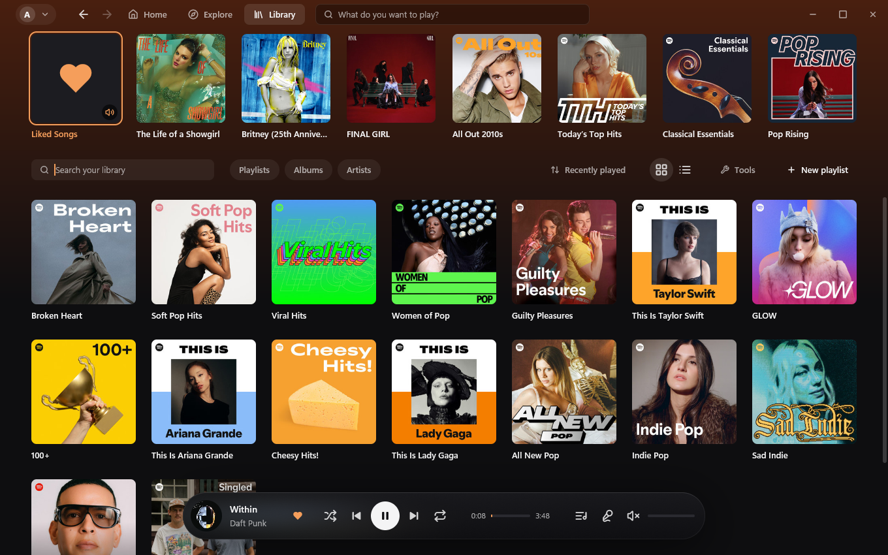
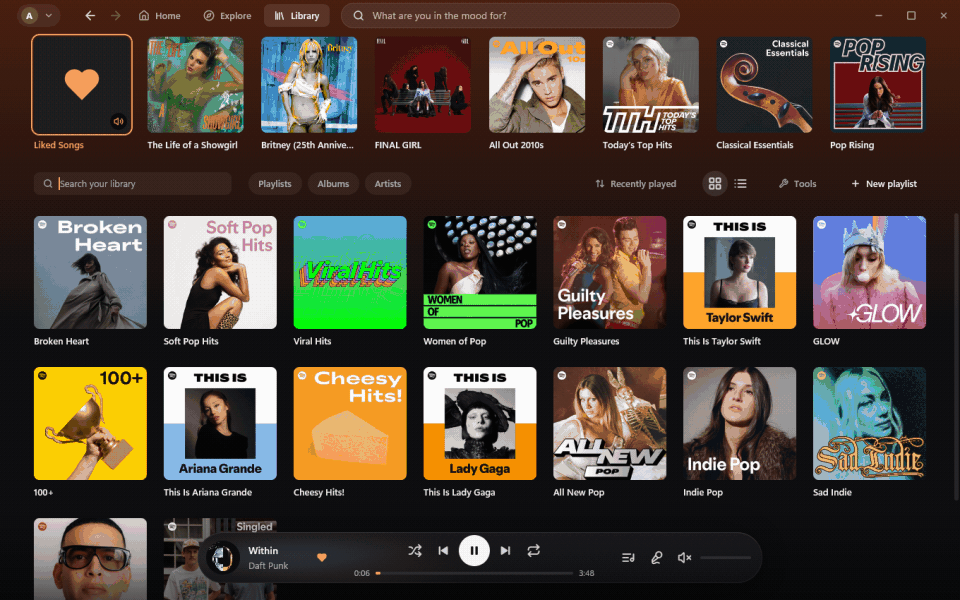
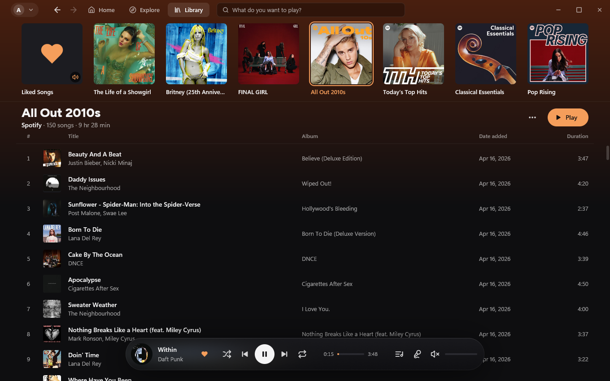
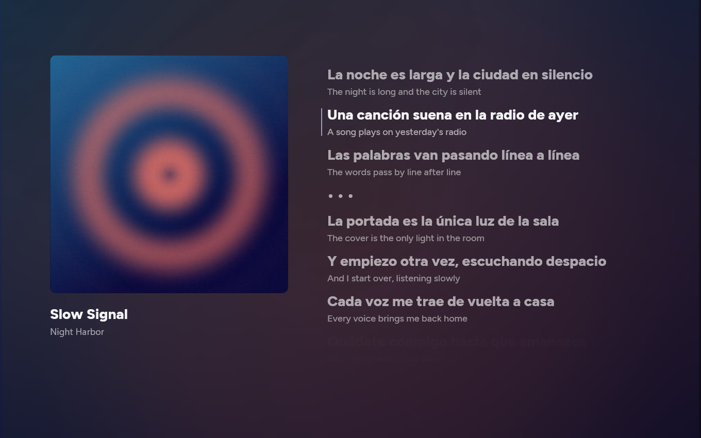
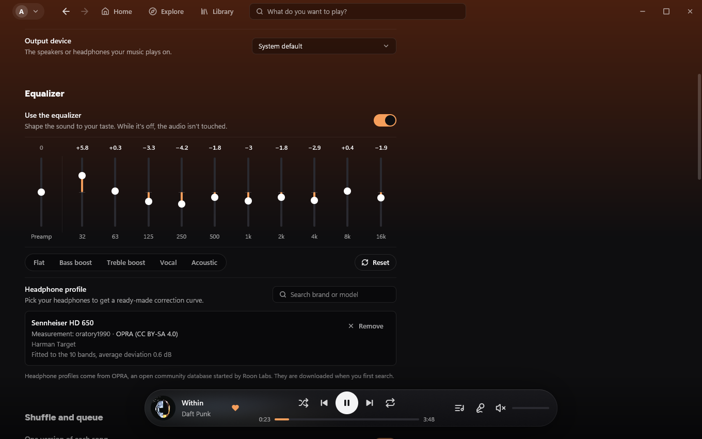
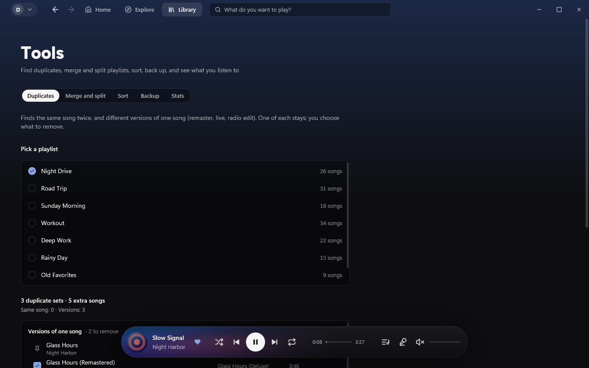
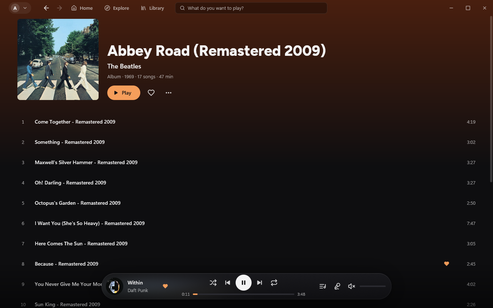
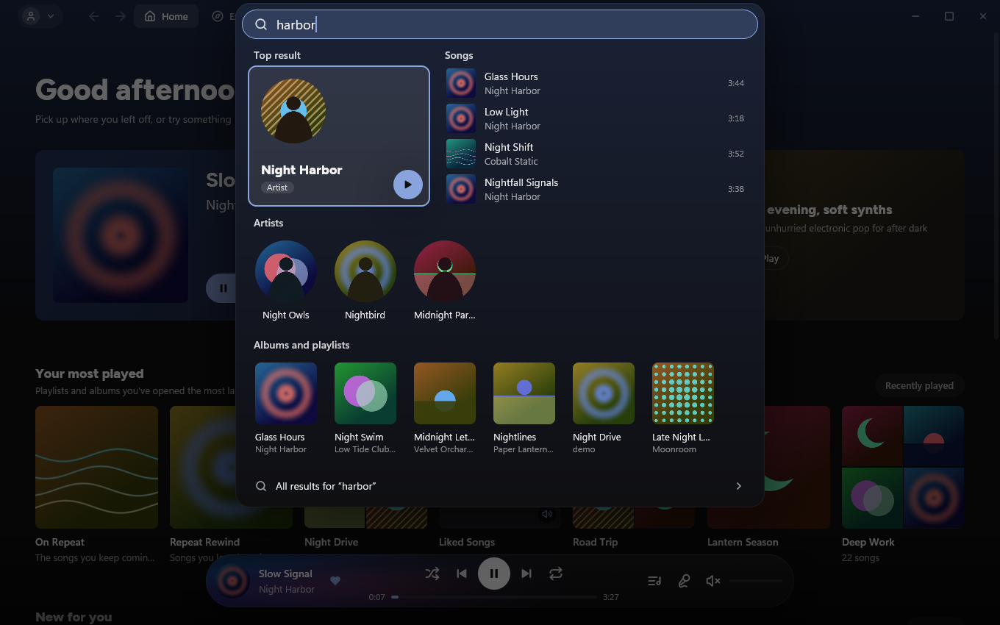
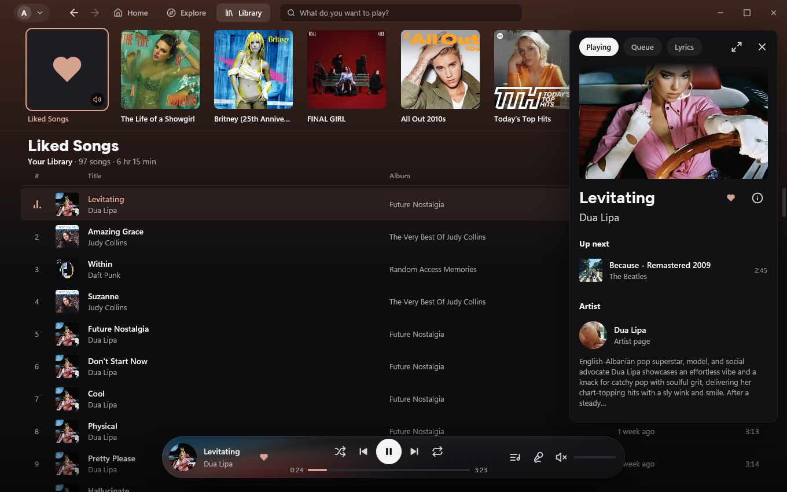

# Openify

A fast, quiet, native Spotify client for Windows. It plays music through your own **Spotify Premium** account, is light on memory and is built for keyboard use.





> **Status:** early (0.1). Friend activity and artist following are **experimental**: they have had only limited testing against a live account and may break. [Download the installer](https://github.com/FurkanKY/Openify/releases/latest/download/Openify-win-Setup.exe) or [build it from source](#build-from-source).

## What it is

Openify is a desktop player written in Rust. The interface is drawn with [gpui](https://gpui.rs) (the UI framework of the Zed editor), playback is done by [librespot](https://github.com/librespot-org/librespot), and everything is stored locally in SQLite. There is no web view and no Electron. It needs a Spotify Premium account: free accounts cannot stream through third-party clients.

## Highlights

- **Light and quick.** Measured on the author's machine with a small library: about 70 MB of memory with the window open, about 50 to 60 MB when hidden in the tray, and the first frame about half a second after launch. Numbers will vary with library size and hardware. Pages you have opened before come from a local cache and appear immediately while they refresh.
- **Keyboard first.** `Ctrl+K` (or a click on the search pill) opens a search surface: a top result, songs, artists, albums and playlists from your library and Spotify, and a few actions when you type their name. `Space`, `Ctrl+←/→`, `Ctrl+↑/↓` and friends control playback, `?` shows every shortcut. Media keys, the tray icon, the Windows media overlay and an optional global search hotkey work too.
- **Gapless playback and crossfade.** Songs that follow each other on an album play without a gap. Optional crossfade between songs (2 to 12 seconds), volume normalization with three levels and quality up to 320 kbps. Playback normally recovers by itself when you unplug or switch an output device.
- **Equalizer and headphone profiles.** A 10-band equalizer with presets and a preamp, and a headphone profile search backed by the open [OPRA](https://github.com/opra-project/OPRA) database: pick your model and get a ready-made correction curve fitted to the ten bands.
- **Library tools.** Find duplicate songs and different versions of the same song (remaster, live, radio edit) in a playlist, merge or split playlists, sort a playlist permanently, back everything up to a JSON file, and see your own listening statistics. Library edits can be undone with `Ctrl+Z`, and edits made while you are offline are queued and sent when you are back online.
- **Lyrics and translation.** Synced lyrics in the side panel or full screen (from Spotify, with [LRCLIB](https://lrclib.net) as a fallback), with an optional translation under every line when one is available.
- **Friend activity (experimental).** An optional panel (off by default) that shows what your friends are listening to. See the privacy section: it uses an unofficial endpoint and has had limited testing.
- **Smarter shuffle and queue rules.** Play only one version of each song, skip explicit songs, never play a chosen artist, hide single songs, start a radio from a song, artist, album or playlist, and use a private session that keeps Openify's own history and statistics from recording anything.
- **Calm interface.** Pages for Home, Explore, Library, artists, albums and search, a floating player, covers that tint the player and the full-screen view, English and Turkish interface languages. The design rules are enforced by tests.

## Screenshots

The screenshots show Spotify's own public playlists and albums with a sample profile.

| | |
|---|---|
|  |  |
| A Spotify playlist with the floating player | Full-screen lyrics with translation |
|  |  |
| Equalizer and headphone profile | Duplicate finder in the library tools |
|  |  |
| An album page | Search (Ctrl+K) |
|  | |
| Now playing panel | |

## Install

1. Download [Openify-win-Setup.exe](https://github.com/FurkanKY/Openify/releases/latest/download/Openify-win-Setup.exe) from the [latest release](https://github.com/FurkanKY/Openify/releases/latest).
2. Run it. Openify installs for your user only (no administrator rights) and opens.
3. Sign in with your Spotify account in the browser window that opens.

The installer is not code-signed yet, so Windows SmartScreen may say "Windows protected your PC". Click **More info**, then **Run anyway**. A portable zip is on the same release page if you prefer not to install.

Openify updates itself in the background and applies the update the next time you open it. If a new version fails to start twice, it goes back to the previous one on its own.

To uninstall, use Windows Settings > Apps.

Requirements: Windows 10 or 11 (64-bit), a Spotify Premium account and a working audio output.

## Build from source

You need Windows 10 or 11, [Rust](https://rustup.rs) (rustup installs the pinned version from `rust-toolchain.toml` on the first build), the MSVC build tools (Visual Studio Build Tools with the "Desktop development with C++" workload) and Git.

```powershell
git clone https://github.com/FurkanKY/Openify.git
cd Openify
cargo build --release
.\target\release\openify.exe
```

The first build compiles gpui and its dependencies and takes a while. No `.env` file or API key is needed. Then run the tests:

```powershell
cargo test --release
```

Read [ARCHITECTURE.md](docs/ARCHITECTURE.md) before a non-trivial change and [DESIGN.md](docs/DESIGN.md) for the design system (some project notes are in Turkish; the identifiers are English). Test hooks and checks are in [TESTING.md](docs/TESTING.md).

## Known limitations

- **Screen readers are not supported yet.** The UI toolkit (gpui 0.2.2) has no accessibility support on Windows: it does not expose a UI Automation tree, so Narrator, NVDA and similar tools cannot read Openify's interface. Keyboard use is well covered (focus order, shortcuts, command palette), but that is not a substitute.
- Dark theme only; there is no light theme yet.
- Windows only (Windows 10 or 11, 64-bit). There are no macOS or Linux builds.
- Needs a Spotify Premium account.
- Some features use endpoints Spotify does not document (friend activity, radio, track credits, lyrics translation) and may stop working without notice. See the disclaimer below.

## Privacy

- Your data stays on your computer. The library cache, play history and statistics live in `%LOCALAPPDATA%\Openify`, settings in `%APPDATA%\Openify`, and the Spotify session in the Windows Credential Manager. Nothing is sent to any server of ours: there is none, and there is no analytics or telemetry.
- **Plays are not reported to Spotify.** Openify's own playback sends no listening reports: the bundled librespot code and Openify's engine contain no call to Spotify's playback-reporting services, and Openify does not scrobble. As a result, songs you play in Openify may not show up in Spotify's Recently played, in your Wrapped, in artists' play counts or in your friends' activity feed; we have not checked each of these on a live account. Playback that you start on another device and transfer to Openify through Spotify Connect goes through Spotify's own Connect protocol, and Spotify may count it. Openify's own Recently played list and statistics are computed locally from your own play history.
- **Spotify Connect is on by default.** Openify registers itself with your Spotify account as a Connect device (named `Openify (<computer name>)` by default), so you can pick it in the device list of the Spotify app on your phone and play to it. It keeps the same device ID between runs and shows up in your account's device list as a persistent device. Turn it off, or rename the device, in the Spotify Connect row of Settings; with it off, Openify registers no device.
- Besides Spotify itself, Openify talks to a few services only when the feature needs them: Spotify's cover image servers, [LRCLIB](https://lrclib.net) for lyrics Spotify does not have, Deezer for the "similar artists" lists (artist names are sent), the OPRA database for headphone profiles (downloaded the first time you search one), and the update server for update checks.
- Friend activity (experimental) is off by default. When you turn it on, Openify asks Spotify's unofficial friend feed endpoint for the list while the panel is open.
- A private session (profile menu) stops Openify from recording recent plays and statistics locally for that session.

## Disclaimer

Openify is an independent project. It is **not affiliated with, endorsed by or sponsored by Spotify AB**. "Spotify" and the Spotify logo are trademarks of Spotify AB; they are used here only to say what Openify works with. Openify talks to Spotify through the same unofficial, reverse-engineered interfaces as librespot, and some of its features use endpoints that Spotify does not document and may change or block at any time. Using third-party clients can conflict with Spotify's terms of service; you use Openify at your own risk. Please do not use it to circumvent Spotify's licensing: it does not download or save music, and it only plays on Premium accounts.

## Contributing

Bug reports, ideas and pull requests are welcome. Please read [CONTRIBUTING.md](CONTRIBUTING.md) first: it explains how to report a problem (with the log file), which checks a pull request must pass and the conventions of the code base.

## License

Openify is licensed under the **GNU General Public License, version 3 or later**. See [LICENSE](LICENSE). Third-party components and their licenses (gpui, librespot, fonts, icons, the OPRA data and every Rust crate) are listed in [THIRD_PARTY_LICENSES.md](docs/THIRD_PARTY_LICENSES.md).

## Türkçe

Openify, Spotify Premium hesabınla çalışan, Windows için yerel, hızlı ve sade bir Spotify istemcisidir. Rust ile yazıldı; arayüz gpui, ses librespot ile gelir. Yazarın makinesinde, küçük bir kütüphaneyle ölçülen değerler: pencere açıkken yaklaşık 70 MB, tepsideyken yaklaşık 50-60 MB bellek, açılışta ilk kare yaklaşık yarım saniye (kütüphane büyüklüğüne ve donanıma göre değişir). Klavyeyle neredeyse her şey yapılır; albüm içindeki şarkılar boşluksuz çalar, isteğe bağlı yumuşak geçiş, ekolayzer ve OPRA kulaklık profilleri, kütüphane araçları (yinelenen bulucu, birleştir / böl, sıralama, yedek, istatistik), çeviri destekli sözler ve deneysel arkadaş etkinliği vardır (arkadaş etkinliği ve sanatçı takibi canlı hesapta yalnız sınırlı denendi). Kütüphane düzenlemeleri Ctrl+Z ile geri alınabilir; çevrimdışıyken yapılanlar kuyruğa alınır. Arayüz İngilizce ve Türkçedir. Verilerin bilgisayarında kalır. Openify çaldıklarını Spotify'a bildirmez: bu yüzden Openify'da çaldığın şarkılar Spotify'ın Son çalınanlar listesinde, Wrapped'da, sanatçıların dinlenme sayılarında ya da arkadaşlarının etkinliğinde görünmeyebilir (hepsini canlı hesapta tek tek doğrulamadık). Spotify Connect varsayılan olarak açıktır: Openify hesabında `Openify (<bilgisayar adı>)` adlı kalıcı bir aygıt olarak görünür; Ayarlar'dan kapatılabilir. Bilinen sınırlar: ekran okuyucular henüz desteklenmiyor (gpui 0.2.2'de Windows UI Automation desteği yok), yalnız koyu tema, yalnız Windows, Premium hesap gerekir. Kurulum dosyası [son sürüm sayfasında](https://github.com/FurkanKY/Openify/releases/latest); dosya henüz imzalı olmadığı için Windows "Bilgisayarınız korundu" derse **Ek bilgi**, sonra **Yine de çalıştır**'a bas. Spotify ile ilişkisi yoktur, Spotify bir Spotify AB ticari markasıdır. Katkı için [CONTRIBUTING.md](CONTRIBUTING.md), lisans GPL-3.0-or-later.
