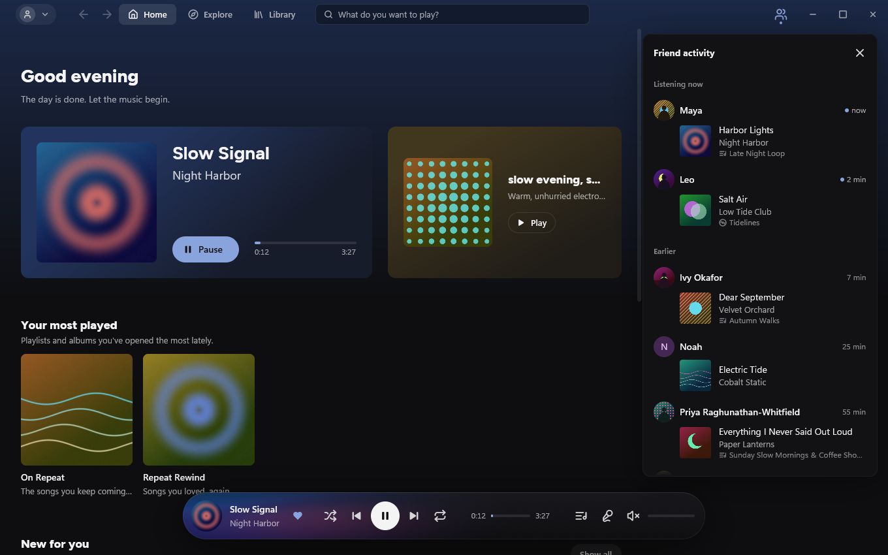

# Openify

A fast, quiet, native Spotify client for Windows. It plays music through your own **Spotify Premium** account, uses a fraction of the memory of the official desktop app and is built for keyboard use.


> **Status:** early. There is no download yet. Releases are coming soon; until then you can [build it from source](#build-from-source).

## What it is

Openify is a desktop player written in Rust. The interface is drawn with [gpui](https://gpui.rs) (the UI framework of the Zed editor), playback is done by [librespot](https://github.com/librespot-org/librespot), and everything is stored locally in SQLite. There is no web view and no Electron. It needs a Spotify Premium account: free accounts cannot stream through third-party clients.

## Highlights

- **Light and quick.** About 95 MB of memory while playing and about 70 MB when hidden in the tray, and a cold start of about half a second, measured on the author's machine (the measurement scripts are in [`scripts/`](scripts)). Pages you have opened before come from a local cache and appear within a frame.
- **Keyboard first.** `Ctrl+K` opens a command palette that searches your library and Spotify and runs commands. `Space`, `Ctrl+←/→`, `Ctrl+↑/↓` and friends control playback, `?` shows every shortcut. Media keys, the tray icon, the Windows media overlay and an optional global search hotkey work too.
- **Gapless playback and crossfade.** Songs on the same album never get a gap. Optional crossfade between songs (2 to 12 seconds), volume normalization with three levels and quality up to 320 kbps. Playback recovers by itself when you unplug or switch an output device.
- **Equalizer and headphone profiles.** A 10-band equalizer with presets and a preamp, and a headphone profile search backed by the open [OPRA](https://github.com/opra-project/OPRA) database: pick your model and get a ready-made correction curve fitted to the ten bands.
- **Library tools.** Find duplicate songs and different versions of the same song (remaster, live, radio edit) in a playlist, merge or split playlists, sort a playlist permanently, back everything up to a JSON file, and see your own listening statistics. All edits can be undone, and edits made offline are queued and sent when you are back online.
- **Lyrics and translation.** Synced lyrics in the side panel or full screen (from Spotify, with [LRCLIB](https://lrclib.net) as a fallback), with an optional translation under every line when one is available.
- **Friend activity.** An optional panel (off by default) that shows what your friends are listening to. See the privacy section: it uses an unofficial endpoint.
- **Smarter shuffle and queue rules.** Play only one version of each song, skip explicit songs, never play a chosen artist, hide single songs, start a radio from a song, artist, album or playlist, and use a private session that records nothing locally.
- **Calm interface.** Pages for Home, Explore, Library, artists, albums and search, a floating player, covers that tint the player and the full-screen view, English and Turkish interface languages. The design rules are enforced by tests.

## Screenshots

All screenshots use a demo library with made-up artists, albums and friends.

| | |
|---|---|
|  |  |
| A playlist with the floating player | Full-screen lyrics with translation |
|  |  |
| Equalizer and headphone profile | Duplicate finder in the library tools |
|  | |
| Friend activity panel | |

## Install

There is no installer yet. **Releases are coming soon** on the Releases page of this repository. When they land, the installer will update itself in the background.

Requirements: Windows 10 or 11 (64-bit), a Spotify Premium account and a working audio output.

## Build from source

You need Windows 10 or 11, [Rust](https://rustup.rs) (stable, 1.85 or newer), the MSVC build tools (Visual Studio Build Tools with the "Desktop development with C++" workload) and Git.

```powershell
git clone https://github.com/FurkanKY/Openify.git
cd Openify
cargo build --release
.\target\release\openify.exe
```

The first build compiles gpui and its dependencies and takes a while. No `.env` file or API key is needed. Then run the tests:

```powershell
cargo test --release
```

Read [ARCHITECTURE.md](ARCHITECTURE.md) before a non-trivial change and [DESIGN.md](DESIGN.md) for the design system (some project notes are in Turkish; the identifiers are English). The screenshot and measurement tools are PowerShell scripts in [`scripts/`](scripts).

## Privacy

- Your data stays on your computer. The library cache, play history and statistics live in `%LOCALAPPDATA%\Openify`, settings in `%APPDATA%\Openify`, and the Spotify session in the Windows Credential Manager. Nothing is sent to any server of ours: there is none, and there is no analytics or telemetry.
- Openify does **not report what you play to Spotify** (no play events, no scrobbles). Its own statistics are computed locally from your own play history.
- Besides Spotify itself, Openify talks to a few services only when the feature needs them: Spotify's cover image servers, [LRCLIB](https://lrclib.net) for lyrics Spotify does not have, Deezer for the "similar artists" lists (artist names are sent), the OPRA database for headphone profiles (downloaded the first time you search one), and the update server for update checks.
- Friend activity is off by default. When you turn it on, Openify asks Spotify's unofficial friend feed endpoint for the list while the panel is open.
- A private session (profile menu) stops Openify from recording recent plays and statistics locally for that session.

## Disclaimer

Openify is an independent project. It is **not affiliated with, endorsed by or sponsored by Spotify AB**. "Spotify" and the Spotify logo are trademarks of Spotify AB; they are used here only to say what Openify works with. Openify talks to Spotify through the same unofficial, reverse-engineered interfaces as librespot, and some of its features use endpoints that Spotify does not document and may change or block at any time. Using third-party clients can conflict with Spotify's terms of service; you use Openify at your own risk. Please do not use it to circumvent Spotify's licensing: it does not download or save music, and it only plays on Premium accounts.

## Contributing

Bug reports, ideas and pull requests are welcome. Please read [CONTRIBUTING.md](CONTRIBUTING.md) first: it explains how to report a problem (with the log file), which checks a pull request must pass and the conventions of the code base.

## License

Openify is licensed under the **GNU General Public License, version 3 or later**. See [LICENSE](LICENSE). Third-party components and their licenses (gpui, librespot, fonts, icons, the OPRA data and every Rust crate) are listed in [THIRD_PARTY_LICENSES.md](THIRD_PARTY_LICENSES.md).

## Türkçe

Openify, Spotify Premium hesabınla çalışan, Windows için yerel, hızlı ve sade bir Spotify istemcisidir. Rust ile yazıldı; arayüz gpui, ses librespot ile gelir. Az bellek kullanır (çalarken yaklaşık 95 MB, tepsideyken yaklaşık 70 MB), klavyeyle her şey yapılır, şarkılar arası boşluk yoktur, isteğe bağlı yumuşak geçiş, ekolayzer ve OPRA kulaklık profilleri, kütüphane araçları (yinelenen bulucu, birleştir / böl, sıralama, yedek, istatistik), çeviri destekli sözler ve arkadaş etkinliği vardır. Arayüz İngilizce ve Türkçedir. Verilerin bilgisayarında kalır; Openify Spotify'a ne dinlediğini bildirmez. Henüz hazır sürüm yok ("Releases yakında"); şimdilik yukarıdaki yönergeyle kaynaktan derleyebilirsin. Spotify ile ilişkisi yoktur, Spotify bir Spotify AB ticari markasıdır. Katkı için [CONTRIBUTING.md](CONTRIBUTING.md), lisans GPL-3.0-or-later.
